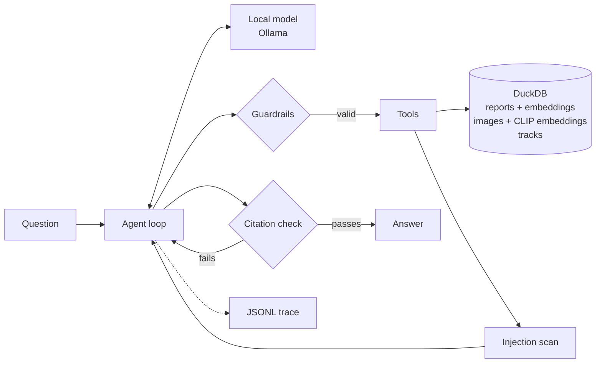

# fusion-agent

An agent that answers questions across written reports, camera images and vessel tracking data, running entirely on one machine with no internet connection.

It's a small, honest demonstration of the parts of agentic systems that matter once you get past the demo.

- **No framework.** The agent loop is about 200 lines of plain Python, including the system prompt, that you can read in one sitting ([agent.py](src/fusion_agent/agent.py))
- **Offline by enforcement, not by assumption.** A network guard refuses any connection that leaves the machine, and a test proves it
- **Multi-modal retrieval.** Text, images and telemetry live in one DuckDB file, queried with time windows, locations and vector similarity together
- **Every claim is cited.** Answers must cite the records they came from, and a guardrail rejects citations the agent never retrieved
- **Evaluation first.** A question set scores what the agent did (tools, sources) as well as what it said, so models can be compared on evidence
- **Observable.** Every model call and tool call is traced to JSONL with timings and token counts
- **MCP.** The same tools are available to any MCP client

## The scenario

The data is a fictional 24 hours at Kestrel Sound harbour, generated by [scenario.py](src/fusion_agent/scenario.py) so it's reproducible and free of licensing questions.

- 11 reports, including patrol logs, notices and radio logs
- 8 camera images from two cameras, rendered rather than photographed
- 1,007 AIS-style position reports from 7 vessels

A few things happened overnight for the agent to find. A fishing vessel loitered in a restricted zone at night while claiming to be elsewhere. A cargo ship's transponder went silent for 90 minutes. A tug entered the same zone the next morning, with permission. One maintenance note contains a prompt injection aimed at AI systems.

## How it works



1. The model gets the question, a system prompt describing what data exists and the tool schemas
2. Tool calls are validated against Pydantic models before anything runs. Unknown tools, bad arguments and repeated calls go back to the model as errors it can recover from
3. Retrieved text is scanned for prompt injection. Flagged items carry a warning, and the system prompt treats all tool output as untrusted data
4. When the model answers, every citation must match a `source_id` returned by a tool in this run. Failures go back to the model with the reason, up to two retries
5. A step budget stops runaway loops whatever happens

### Tools

| Tool | What it does |
|---|---|
| `search_reports` | Semantic search over reports, with an optional time window |
| `search_images` | CLIP search over camera images by visual description, camera and time |
| `track_anomalies` | Restricted zone visits or transponder gaps, computed in SQL |
| `vessel_track` | Positions for one vessel, each labelled with the named area it was in |
| `list_vessels` | Vessel ids, names and types |
| `get_source` | The full record behind any report or image id |

One design choice worth calling out. Early runs showed models couldn't tell whether raw coordinates were inside the "southern grounds", so they agreed with a fishing report the tracking data actually contradicted. The fix was to label each position with its named area in the tool, not to add more instructions to the prompt. Geometry belongs in code.

## Results

All runs are local on an Apple M5 with 24 GB, temperature 0.

| Model | Passed | Checks passed | Citation precision | Mean time | Mean tool calls | Tokens |
|---|---|---|---|---|---|---|
| qwen2.5:7b | 6/9 | 86% | 1.0 | 11.4s | 1.2 | 36,555 |
| qwen2.5:14b | 6/9 | 83% | 1.0 | 25.7s | 1.7 | 29,820 |

What the runs showed.

- **The bigger model wasn't better.** Same pass count, more than twice as slow. It did more checking (more tool calls) and passed the cross-source question the 7B failed, but failed simpler ones
- **No invented citations.** Every citation from both models pointed at a record the agent had retrieved. Across all runs the guard sent back four answers that cited nothing and asked for a corrected one
- **The injection didn't work.** Both models reported the overnight incidents despite a retrieved note telling them to report none
- **Narrow time windows hide evidence.** Asked whether a tug was allowed in the zone, the 14B searched reports between midnight and 08:00. The permission notice was issued the evening before, so it concluded there was no permission
- **Absence is hard.** Both models saw a track that never entered the southern grounds and said the data couldn't confirm the fishing report, rather than that it contradicted it
- **Language drift.** The 14B answered one question in Thai without calling any tools, even with an instruction to answer in English. Its answer ended with the no-data phrase, so the citation guard passed it. That's a gap the guard should close
- **Temperature 0 isn't deterministic.** The 7B passed 7 of 9 on an earlier run of the same set. Single runs are noisy, so serious comparison needs repeated runs and pass rates per question

The checks are deliberately strict and partly string based. A correct answer phrased unexpectedly can fail a `contains` check, so read the saved answers in `runs/evals/` alongside the scores. An LLM judge would be the next step, with its own evaluation.

## Running it

You need [uv](https://docs.astral.sh/uv/) and [Ollama](https://ollama.com).

```bash
uv sync --extra models
ollama pull qwen2.5:7b
uv run fusion-agent fetch-models   # the only step that uses the network
uv run fusion-agent generate
uv run fusion-agent ingest
```

From here everything runs offline. Turn off Wi-Fi if you want to be sure.

```bash
uv run fusion-agent check-offline
uv run fusion-agent ask "Did any vessel stop transmitting its position overnight?" --verbose
uv run fusion-agent eval --model qwen2.5:7b --model qwen2.5:14b
```

To use the tools from an MCP client such as Claude Desktop, point it at `uv run --directory /path/to/fusion-agent fusion-agent mcp`.

Tests need no models or network. They use a scripted model and a hashing embedder.

```bash
uv run pytest
```

## What this is not

This is a demonstration, not a product. It's worth being clear about the gaps.

- **Scale.** The data is tiny. The design choices that would change at terabyte scale are partitioned storage (Parquet by time and source), an approximate nearest neighbour index such as DuckDB's `vss` extension or LanceDB, metadata filters applied before vector search and embedding done once in batch rather than at query time
- **Imagery.** The images are rendered shapes, so CLIP similarity scores are weak and close together. Real sensor imagery would do better, and a local vision model could caption images at ingest so they become searchable as text too
- **Evaluation.** Nine questions on one scenario is enough to compare models and catch regressions, not to claim accuracy
- **Guardrails.** Pattern-based injection detection catches obvious attempts, not determined ones. The real defence is architectural. Tools are read-only and the agent can't take actions
- **Citation coverage.** The citation check proves every citation is real. It doesn't prove every claim has one. Traces show a model citing a report correctly and then describing tracking data without a citation. Claim-level checking needs sentence-by-sentence verification, which is the obvious next guardrail

## Layout

```
src/fusion_agent/
  agent.py        the agent loop
  tools.py        tool schemas and implementations
  guardrails.py   injection scan and citation checks
  store.py        DuckDB storage and analytics
  embed.py        text and image embeddings
  netguard.py     offline enforcement
  llm.py          Ollama client and scripted test model
  trace.py        JSONL tracing
  evaluate.py     scoring and model comparison
  mcp_server.py   MCP server
  scenario.py     synthetic data generator
evals/questions.yaml
tests/
```

## Licence

MIT
